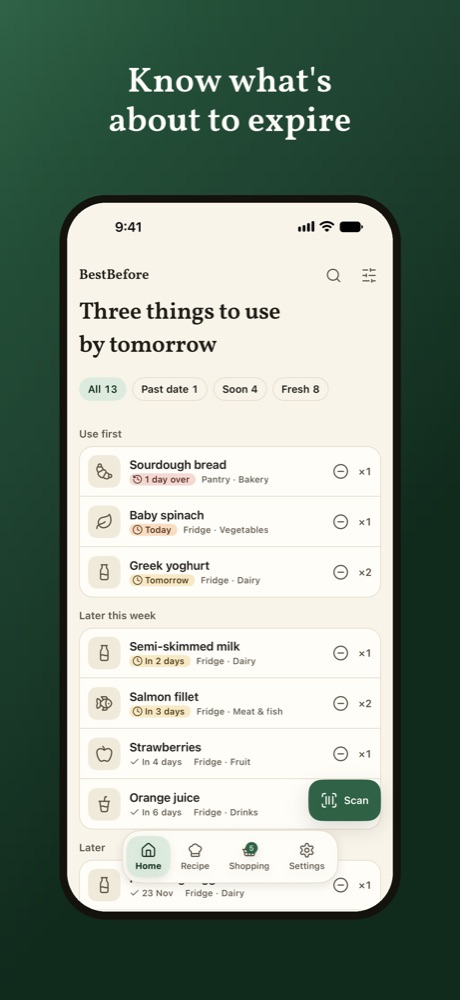
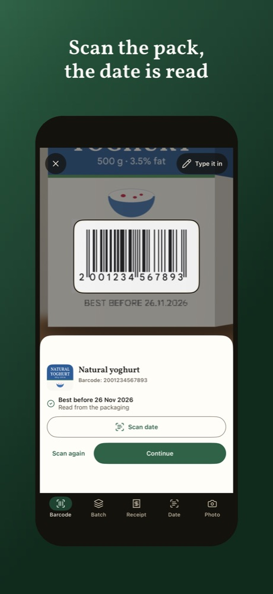
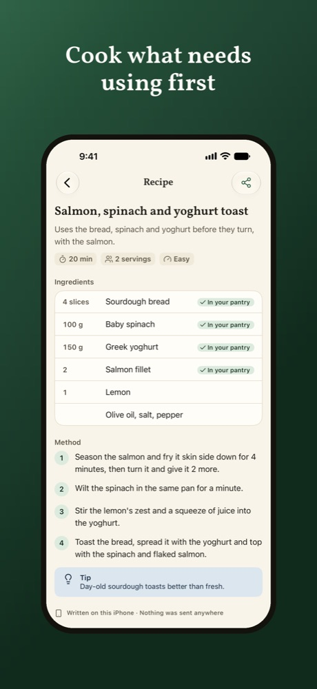
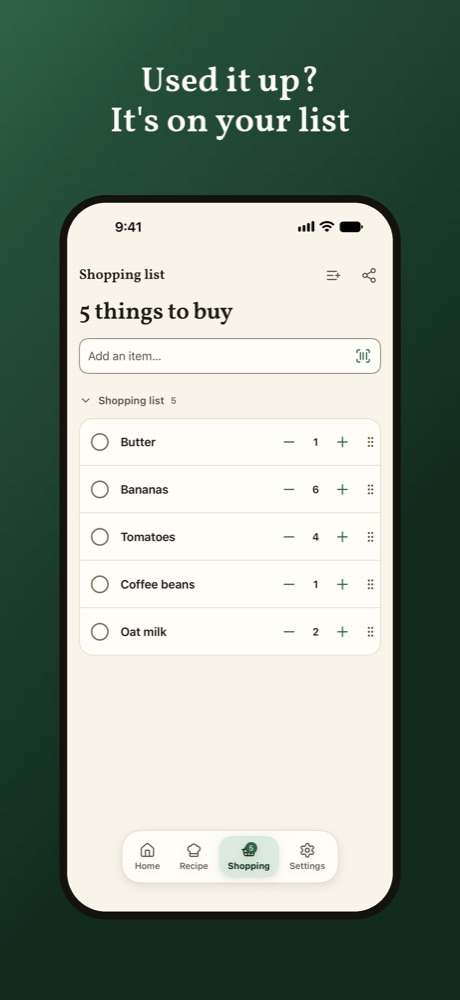

# BestBefore (FoodTracker)

Scan your groceries, see what to use first, get a reminder before food goes off, and turn what's about to expire into a recipe. Free and open source, for iPhone, iPad and Android.

- **iPhone and iPad**: [BestBefore on the App Store](https://apps.apple.com/app/id6818647200)
- **Google Play**: in closed testing, not public yet

<p>
  
  
  
  
</p>

**What it does**

- Scan a barcode and the product name and picture are filled in from [Open Food Facts](https://world.openfoodfacts.org/); point the camera at the printed date and it reads the expiry date.
- Lists what expires first in the fridge, freezer and pantry, and reminds you a few days before, at a time you choose.
- Shopping list: essentials you use up go onto it; share it as text or a QR code.
- Home screen widgets for expiring items, the shopping list and an overview.
- Recipe tab: picks the items closest to their date and writes a recipe in one of three ways: a prompt to copy into an AI app you already use (free), the phone's own model where it has one (free), or the server, with optional one-off packs of sparks (in-app purchase; one spark is one recipe from the server) that also plan menu sets: 1 to 4 days, up to three courses a day. A written recipe's missing ingredients go onto the shopping list in one tap.
- The pantry stays on your device, and you don't need an account. Only a recipe from a pack sends anything to the project's server.
- English, Russian, Norwegian, Spanish, German, French, Swedish and Danish. Open source under the Apache License 2.0.

**Built with** Kotlin Multiplatform and Jetpack Compose (Android), SwiftUI (iOS, a separate native app), and product data and pictures from [Open Food Facts](https://world.openfoodfacts.org/) (Open Database License; pictures CC BY-SA).

The project is called FoodTracker in the code; the app is published as BestBefore.

## Features in detail

- 📷 **Barcode Scanning**: Scan 1D and 2D barcodes (EAN-13, UPC, Code 128, DataBar, QR).
- 🏷️ **Automatic Product Lookup**: Queries the open [Open Food Facts API](https://world.openfoodfacts.org/) to fetch product names, brands, images, and categories.
- ⚡ **GS1 Barcode Expiration Extraction**: Decodes expiration dates directly from GS1 barcodes containing Application Identifiers `(17)` or `(15)`.
- 🤖 **On-Device Machine Learning Date OCR**:
  - Point your phone's camera at the printed expiration date stamp on any packaging (`EXP 24.11.2026`, `BEST BEFORE 15 NOV 2026`, `BB 05/12/26`).
  - Google ML Kit on Android and Apple Vision on iOS extract and parse the date in real time with 1-tap confirmation.
- 📸 **Product Photo Fallback**: Snap photos and manually name bakery, market produce, or custom items that lack barcodes.
- ⏱️ **Pantry Management Dashboard**:
  - Color-coded shelf-life urgency: **Expired** (Red), **Expiring Soon** (Amber, within 3 days), and **Fresh** (Green).
  - Filter by storage location (**Fridge**, **Pantry**, **Freezer**).
  - Search by name or brand.
  - Quick swipe actions to mark items as *Consumed* or *Delete*.
- 🛒 **Shopping List**: essentials you use up move onto it; share it as text or a QR code.
- 🍳 **Recipes from what's expiring**: the Recipe tab picks the items closest to their date and writes a recipe in one of three ways:
  - **Shared prompt** (free): the prompt is copied or shared to an AI app the user already has. Nothing comes back to the app.
  - **On this phone** (free): Gemini Nano through ML Kit's Prompt API on supported Android phones, Apple Foundation Models on iOS 26 and later. Nothing is sent.
  - **From a pack** (paid): packs of 10, 50 or 100 sparks are in-app purchases (the app calls the paid unit a spark: one spark is one recipe written by the server). The project's Cloud Functions write the recipe with Gemini on Vertex AI. A menu set (1 to 4 days, 1 to 3 courses a day, the main course first) is server-only and takes several sparks (by default days + courses − 1, so 1 to 6). What each takes is set by the server, not the app. A single recipe from a pack can come with pictures made by AI (the dish, or the dish and the steps that are hard to follow from words), for a few more sparks; the picture model gets only a short description of the dish that the recipe model writes and the server checks, with nothing the person typed copied into it. A recipe or menu from a pack can be reported from its result ("Report this recipe").

## Project Structure

- `shared/`: Kotlin Multiplatform shared domain, Open Food Facts Ktor client, GS1 parser, Date OCR parsing heuristics, the pantry state holder and repository interfaces. Only the Android app uses it.
- `androidApp/`: Native Android application built with Jetpack Compose (Material 3), CameraX, Google ML Kit and Room.
- `iosApp/`: Native iOS application built with SwiftUI, AVFoundation, Apple Vision and SwiftData. It is a separate implementation and does not link `shared/`, so a logic change on one platform has to be ported to the other by hand.
- `functions/`: the backend for recipes from paid packs, Cloud Functions (TypeScript) on Firebase with Firestore, Auth and App Check. See [functions/README.md](functions/README.md) and the client wire contract in [functions/CONTRACT.md](functions/CONTRACT.md). Owner setup steps: [docs/recipe-setup.md](docs/recipe-setup.md).

The pantry stays on the device, and there is no sync of it. The app's network calls are barcode lookups on Open Food Facts, crash reports to Firebase Crashlytics (release builds), the store's own purchase screens, and, only once someone starts a purchase, the recipe backend: an anonymous Firebase Auth user (or an Apple or Google sign-in, if the buyer chooses one), App Check, and the Cloud Functions. A recipe from a pack sends the names, dates and quantities of the items ticked for it, the names of the person's staples, the recipe settings and the allergen list; a report sends the reason and the person's optional note. Nothing reaches the backend for someone who only uses the free routes.

## Building and Running

Requires JDK 17 for Android and Xcode for iOS. See [CONTRIBUTING.md](CONTRIBUTING.md) for the one-time setup (a debug keystore, and your own signing team for running on an iPhone).

### Run Unit Tests
```bash
./gradlew :shared:testAndroidHostTest :androidApp:testDebugUnitTest
cd functions && npm ci && npm test   # backend, against the Firebase emulators (Node.js 24, Java 21+)
```

### UI screenshot check

A quick answer to "did I change any Android screen I didn't mean to?", on the JVM with no emulator ([Roborazzi](https://github.com/takahirom/roborazzi) on Robolectric, about half a minute):

```bash
scripts/ui_check.sh            # compare every screen with its baseline: exit 0 none / 1 differences / 2 failed to run
scripts/ui_check.sh --record   # accept the current UI as the new baseline (then review and commit the images)
```

- **What is checked**: every `@Preview` under `androidApp/.../ui/`, found automatically (private ones too), with its own size, locale, font scale and dark/light setting; a preview with no dark variant of its own is also taken in dark (`_NIGHT`). A new `@Preview` is covered with no other work, but fails as "without a baseline" until it is recorded. Home, the shopping list and the add/edit form take a `PantryStateHolder` and have no preview, so `ScreenScreenshotTest` builds them over in-memory data.
- **Baselines**: `androidApp/src/test/snapshots/images/`, one PNG per preview and variant, named after its file, function and variant, so a renamed or removed preview shows in `git status` after a record.
- **When something changed**: the script lists the screenshots; `androidApp/build/outputs/roborazzi/<name>_compare.png` shows reference, diff and new side by side, and `androidApp/build/reports/roborazzi/debug/index.html` has them all. If the change was meant, record and commit the new images with the code.
- **Strict and fixed**: one pixel off by more than Roborazzi's anti-aliasing tolerance fails, so a 1dp shift or a small colour change does. Device (Pixel 5, en-GB), SDK 34, time zone (UTC) and the animation clock (10 s) are fixed, dates come from the sample data, never from today, and pictures never load from the network.
- **On a pull request**: the baselines are recorded on macOS, and Robolectric's rendering can differ slightly on Linux, so CI never compares with them. Plain `./gradlew :androidApp:testDebugUnitTest` (the `android` job) renders every preview, so a preview that crashes fails there. On a pull request touching Android, the `ui-screenshots` job renders the pull request's base (with the base's own `scripts/ui_check.sh --record`, cached per base commit and runner image) and its head on Linux and compares the two (`scripts/ui_diff.py`). With differences, one comment on the pull request, updated in place on every push, gives the counts (changed, new, removed) and up to 20 of them inline as reference | diff | new, the rest by name; the images are on the `screenshot-diffs` branch under `pr-<n>/`, removed when the pull request closes, and every image is in the run's artifact. A later push without differences, or after which the pull request no longer touches Android, rewrites the comment to say so; a pull request that never had any gets no comment. A difference never fails the job, only a build error or a crash does; a base older than the check has nothing to compare with and passes. A fork's pull request gets the artifact and the job summary only (its token can't comment). A same-repo `release/v*` pull request runs none of it, like the rest of CI.
- This is not `scripts/screenshot_check.py` (below), which re-takes the store screenshots on an emulator and a simulator and is much slower.

### Build Android App
```bash
./gradlew :androidApp:assembleDebug
```

### Build iOS App
```bash
xcodebuild -project iosApp/FoodTracker.xcodeproj -scheme FoodTracker -destination 'generic/platform=iOS Simulator' build
```

## Releasing

This section is for the maintainer: publishing needs the repository's store credentials.

Merging to `main` publishes nothing; CI only tests and builds it (a merged pull request other than a release one is not built again on `main`, as its pull request runs built it). A release goes out in two steps:

1. **Start it**: `scripts/release` (add `--dry-run` to try it without changing anything). It
   lists the commits on `origin/main` since the last `vX.Y.Z` tag and asks for a patch, minor or
   major bump. Then it has the Claude CLI write store release notes in every listing language
   (en-GB, ru-RU, no-NO, es-ES, es-419, de-DE, fr-FR, fr-CA, sv-SE, da-DK; Play's codes, which
   `scripts/testflight.py` maps to App Store Connect's) for you to accept, edit or regenerate. It creates
   `release/vX.Y.Z` with the version bump in `Version.xcconfig` and
   `release-notes/vX.Y.Z/<locale>.txt`, pushes it and opens a PR.
2. **Internal testing**: CI publishes every push to `release/v*` to the Google Play internal track
   and to the internal TestFlight testers, with those notes. Fixes for the release go on the
   branch; each push becomes a new internal build.
3. **Play closed testing and the App Store**: merging the PR promotes the newest internal Play
   build of that version to closed testing (`alpha`), then applies the Play store listing from
   `store-listing/google-play/` (texts, phone screenshots, feature graphics, icon; job
   `play-listing`). It also puts the newest TestFlight build of the version on its App Store
   version, with the notes as "What's New", sets the listing from `store-listing/app-store/`
   (name, subtitle, keywords, description, promotional text, the screenshot sets and the App
   Review notes) and submits it for App Review together with the in-app purchases still to be
   reviewed (the first ones must go with a version); if the listing can't be applied in full, or
   App Store Connect refuses the purchases, nothing is submitted and the job says what to do
   before a re-run carries on (`store-listing/app-store/README.md`, "Changing the listing
   texts"). After App Review rejected a version, the next release takes over that version (it
   is renamed to the new number) and its review submission, which App Review left with
   unresolved issues: the job marks the rejected items it ships again resolved (the version's,
   and those of in-app purchases still to be reviewed in it), then resubmits it, as the website's
   "Resubmit to App Review" does; `testflight.py iaps` shows that step read-only. Another
   rejected item in it, or App Store Connect refusing the step, stops the job; then resubmit by
   hand (App Store Connect > App Review > the submission with unresolved issues > Resubmit to App
   Review), with no need to re-run the job, as the build and listing are already on the version.
   It goes live as soon as Apple approves it (set the repository variable
   `APP_STORE_RELEASE_TYPE` to `MANUAL` to release it from App Store Connect yourself). Then it
   tags `vX.Y.Z` and creates a GitHub release.

**Google Play production**: the Android app has no production release yet. A new personal
developer account needs a closed test with at least 12 testers opted in for 14 days in a row
before it can apply for production access; the steps, dates and declarations are in
[docs/play-production.md](docs/play-production.md), and the tester invitations in
[docs/marketing/play-testers/](docs/marketing/play-testers/README.md).
`PLAY_SERVICE_ACCOUNT_JSON="$(cat key.json)" python3 scripts/play_status.py` prints, read-only,
each track's releases, countries and tester groups.

**Store listings**: edit the files in `store-listing/` on the release branch (or before it), and
the merge puts them in both stores; only what differs is written, the iPhone Duo screenshots
and the App Store "Header and Search Results" images (`header.png`, `search-result.png`)
included (through the App Asset Library). To see the difference with what the stores have,
without writing anything (`--apply` writes; `screenshots --inspect` prints the raw sets,
library images and placements):

```sh
ASC_KEY_ID=… ASC_ISSUER_ID=… ASC_KEY_PATH=… python3 scripts/testflight.py listing
ASC_KEY_ID=… ASC_ISSUER_ID=… ASC_KEY_PATH=… python3 scripts/testflight.py screenshots
ASC_KEY_ID=… ASC_ISSUER_ID=… ASC_KEY_PATH=… python3 scripts/testflight.py iaps   # in-app purchases
PLAY_SERVICE_ACCOUNT_JSON="$(cat key.json)" python3 scripts/play_listing.py --images
python3 -m unittest discover -s scripts/tests     # the sync's tests, offline
```

The App Store commands compare with the version in preparation; while none is (between a
release's submission and the next merge), they compare with the newest version and say so.

**Changing a pack's price**: the spark packs' USD base prices are one table,
`scripts/pack_prices.py`, which both stores are set from (Play converts the USD price to every
region; on the App Store the United States is the base territory and Apple's equalisation sets the
other storefronts). Edit it, then compare with what the stores charge; the dry runs print old and
new prices for the US and a few regions, and write nothing:

```sh
PLAY_SERVICE_ACCOUNT_JSON="$(cat key.json)" python3 scripts/play_products.py --reprice
ASC_KEY_ID=… ASC_ISSUER_ID=… ASC_KEY_PATH=… python3 scripts/testflight.py iap-prices
```

To change the prices, the same with `--apply` (each takes product ids to limit it, e.g.
`recipes_10`). Play's change patches only the `buy` option's prices; App Store Connect's is a new
price schedule starting now, which replaces any manual price set by hand in another storefront or
scheduled for later (the dry run lists them). Neither runs in CI.

```sh
PLAY_SERVICE_ACCOUNT_JSON="$(cat key.json)" python3 scripts/play_products.py --reprice --apply
ASC_KEY_ID=… ASC_ISSUER_ID=… ASC_KEY_PATH=… python3 scripts/testflight.py iap-prices --apply
```

**Changing a pack's name**: the names and descriptions the stores' purchase dialogs show are
`LISTINGS` in `scripts/play_products.py` (Play, per Play language; its titles are the app's
`recipe_pack_name`) and `IAP_LISTINGS` in `scripts/testflight.py` (App Store, per locale: the
name taken from Play's title, a description of at most 45 characters, the name at most 30);
`scripts/tests/test_pack_names.py` checks both against the app's strings and the limits. Edit
them, then compare; the dry runs print what the stores have and old -> new per product and
language, and write nothing:

```sh
PLAY_SERVICE_ACCOUNT_JSON="$(cat key.json)" python3 scripts/play_products.py --relist
ASC_KEY_ID=… ASC_ISSUER_ID=… ASC_KEY_PATH=… python3 scripts/testflight.py iap-names
```

With `--apply`, Play's patches only the listings (prices, purchase option and its state stay) and
takes effect without review. On the App Store a display name lives on an In-App Purchase
version, which can't be edited once submitted: `iap-names --apply` edits the draft version if
there is one, else makes a new one from the approved version and edits that. The draft then has
to pass App Review: the next release's `testflight.py appstore` adds it to the app version's
review submission (`testflight.py iaps` shows it as "added"); until it is approved, the store
keeps the approved version's texts. It refuses while a version of the purchase is in review or
in a submission. A locale a purchase has no localization for is only reported; `--add-missing`
adds it. Neither runs in CI.

**Screenshot check**: `scripts/screenshot_check.py` takes every screenshot the store capture
scripts take (`scripts/android_screenshots.sh`, `scripts/ios_screenshots.sh`) on each of their
devices in turn, booting one, shooting every language, shutting it down before the next, and
compares them with a local baseline through [reg-cli](https://github.com/reg-viz/reg-cli)
(`npx reg-cli@0.18.16`). It refreshes nothing in `store-listing/`. One command, unattended:

```sh
scripts/screenshot_check.py                                   # every default device, all eight languages
scripts/screenshot_check.py --platform ios --langs en,de      # a subset; --devices android-phone,ios-ipad-13
scripts/screenshot_check.py --approve-last                    # the last run becomes the baseline (no capture)
scripts/screenshot_check.py --approve                         # capture, compare, then make it the baseline
```

The tools' output goes to `build/screenshot-check/run.log`; the terminal gets the shots and time
per device, then changed / new / deleted / unchanged with each changed file's share of differing
pixels. The side-by-side report is `build/screenshot-check/report/index.html`, the same in JSON
`build/screenshot-check/summary.json`. Exit code 0: no differences (or a baseline approved), 1:
differences, 2: the run failed or there is no baseline yet. The baseline is local and
git-ignored (`build/screenshot-check/expected/`, only framed store images are committed): make
one on `main` (`--approve`), then run on your branch the same day, since the scan's pack date
and the menu's days follow today's date (the summary says when the baseline is from another
day). It refuses to start while another emulator or simulator is running (`--ignore-running`
overrides). `--no-build` reuses the last build, `--no-capture` compares the last captures again,
`--keep-device` leaves each device running. The iPhone Duo's inner display (`ios-duo-inner`)
runs only when named, because unfolding it needs Xcode's Device Hub (`scripts/duo_pose.sh`).

**Version**: `Version.xcconfig` holds the one version of both apps. Gradle reads it for Android's
`versionName`, and it is the Xcode project's base configuration, so the app and the widget get it
as `MARKETING_VERSION`. Don't set the version anywhere else.

Needs `gh` (logged in) and `claude` on your PATH. Play rejects notes longer than 500 characters
per language, and the script checks that. App Review needs the version page in App Store Connect
complete (App Privacy, App Review contact); the job says so if Apple refuses the submission.

## Contributing

Issues and pull requests are welcome. See [CONTRIBUTING.md](CONTRIBUTING.md). To report a security problem, see [SECURITY.md](SECURITY.md).

## License

FoodTracker is licensed under the [Apache License 2.0](LICENSE).

The license covers the code. It does not cover the "BestBefore" name, the app icon or the store-listing artwork in `store-listing/`. Please use your own name and icon if you publish a fork to an app store.

The app bundles the Vollkorn typeface (SIL Open Font License 1.1) and Lucide icons (ISC License). Their licence texts ship in the app, in `androidApp/src/main/assets/licenses/`.

Product data and pictures come from [Open Food Facts](https://world.openfoodfacts.org/), under the Open Database License (database) and Creative Commons Attribution-ShareAlike (pictures).
